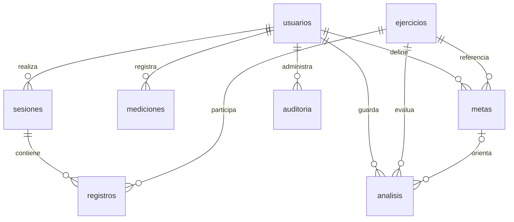

# Base de datos del gimnasio

Supabase aloja PostgreSQL; FastAPI en Render consulta el esquema privado `gym_app` con SQLAlchemy. React en Vercel consume FastAPI: no utiliza claves de Supabase ni accede directamente a las tablas. Login y permisos pertenecen al backend, no a Supabase Auth.

## Estructura y relaciones

| Tabla | Responsabilidad | Relaciones |
|---|---|---|
| usuarios | Cuenta, hash Argon2, rol, estado y perfil | Origen de mediciones, sesiones, metas y análisis |
| mediciones | Peso, fecha y talla histórica | usuario_id → usuarios |
| ejercicios | Catálogo y estado activo | Referenciado por registros, metas y análisis |
| sesiones | Cabecera de entrenamiento | usuario_id → usuarios |
| registros | Detalle: ejercicio, series, repeticiones y carga | sesion_id → sesiones; ejercicio_id → ejercicios |
| metas | Carga objetivo y repeticiones por cuenta y ejercicio | usuario_id → usuarios; ejercicio_id → ejercicios |
| analisis | Instantánea JSON del resultado del predictor | usuario_id → usuarios; ejercicio_id → ejercicios; meta_id → metas |
| auditoria | Acción administrativa, actor, recurso y fecha | actor_id → usuarios |

Son ocho tablas de dominio, diez claves foráneas y una tabla técnica `alembic_version`. `registros` materializa la relación muchos a muchos entre sesiones y ejercicios y conserva los atributos de cada ejecución. Una sesión admite varias filas del mismo ejercicio; el backend agrupa su carga máxima para comparar sesiones.



## Integridad

Correos y nombres normalizados de ejercicios son únicos. Las claves foráneas impiden referencias inexistentes. Peso: 20–400 kg; talla: 0.50–2.50 m; edad: 18–120 años; carga: 0–600 kg; meta: mayor que cero y hasta 600 kg; series: 1–20; repeticiones: 1–100. La API valida además decimales, fechas, formato de correo y campos obligatorios.

Cada solicitud usa una transacción. Si falla un ejercicio de una sesión, no se guarda una parte de ella. Eliminar una sesión elimina sus registros mediante `ON DELETE CASCADE`. Eliminar una meta conserva los análisis históricos y deja `meta_id` nulo mediante `ON DELETE SET NULL`. Desactivar ejercicios conserva el historial. Usuarios se desactivan desde la administración; no hay borrado indiscriminado de cuentas.

Mediciones conservan su talla histórica. Volumen e IMC se calculan al consultar; no se guarda una copia que pueda quedar desactualizada. El estado de una meta se deriva del historial actual, mientras que el resultado del análisis es una instantánea fechada.

## Acceso y migraciones

Las migraciones 0001, 0002 y 0003 crean el modelo, reservan el esquema al backend y completan los índices de claves foráneas. La 0004 agrega `metas.repeticiones_objetivo`, nullable para conservar las metas existentes y restringido a 1–100 cuando se especifica. No cambia relaciones ni elimina datos. Los análisis guardan la versión, repeticiones y errores del modelo en el JSON existente; los resultados anteriores no se reinterpretan. Hay 21 índices en total, incluidos los índices de claves primarias y unicidad. La estructura está registrada en `gym_app.alembic_version`; las aplicaciones de SQL por Supabase quedan también registradas en su historial de migraciones.

Se revocó acceso de PUBLIC, anon y authenticated al esquema, tablas y secuencias. Las ocho tablas tienen RLS activado sin políticas públicas: es deliberado, porque el backend conectado como postgres aplica los permisos de aplicación. Supabase muestra un aviso informativo por no haber políticas RLS. No se debe resolver creando políticas de acceso abierto. Si se cambia la conexión a un rol PostgreSQL limitado, hay que definir sus permisos y políticas antes de usarlo.

El asesor de rendimiento ya no detecta claves foráneas sin índice. Avisos de índices todavía no usados en una base nueva no justifican eliminarlos: su utilidad se evalúa con carga real.

## Demostración

La cuenta `demo.gimnasio@example.com`, llamada **Demo Gimnasio**, contiene datos ficticios para explicar el funcionamiento: ocho sesiones semanales, tres ejercicios por sesión, dos mediciones y una meta de press de banca de 50 kg. La carga de press progresa de 32 a 46 kg en incrementos de 2 kg por semana. Las credenciales se entregan en privado, nunca en el repositorio.

El usuario demostrativo debe mostrar 8 sesiones, 24 registros y volumen acumulado de 28 584 kg. Si el último registro comparable tiene como máximo 28 días de antigüedad, el predictor lineal debería estimar la siguiente carga en 48 kg y aproximadamente dos semanas hasta 50 kg. Es un ejemplo matemático construido, no evidencia de precisión del modelo con deportistas reales ni una recomendación sobre cuánto levantar.

Recorrido: iniciar sesión → Inicio → revisar calendario y rendimiento → Entrenamiento → consultar historial → Análisis → seleccionar press de banca y meta → ejecutar análisis → recargar Inicio. Con el administrador, revisar Usuarios, el detalle de Demo Gimnasio y los entrenamientos.

Para demostrar integridad y roles, una cuenta de usuario debe recibir 403 en `/admin/resumen`; un visitante sin token, 401 en `/sesiones`; un correo mal formado, 422 en registro. Una sesión con un ejercicio inexistente debe devolver 422 sin aumentar el historial. El administrador no ejecuta el modelo (403).

## Conectar Vercel

Configura en el proyecto del frontend, para Production:

```text
VITE_API_URL=https://gym-ai-backend-2ne5.onrender.com
```

Luego vuelve a desplegar el frontend. El modo demo local del frontend es independiente de la cuenta demostrativa real: utiliza **Iniciar sesión**, no el botón de demo local, para comprobar Supabase. CORS está configurado para `https://gym-frontend-beta-eight.vercel.app`.

Render debe usar `/health` como Health Check Path. La ruta ejecuta `SELECT 1`; una respuesta 200 confirma conectividad, pero el funcionamiento completo requiere verificar login y guardado. El plan gratuito puede tardar en despertar después de inactividad; no se ha medido capacidad de usuarios concurrentes.

Avisos informativos del asesor: [RLS activado sin políticas públicas](https://supabase.com/docs/guides/database/database-linter?lint=0008_rls_enabled_no_policy) e [índices todavía no utilizados](https://supabase.com/docs/guides/database/database-linter?lint=0005_unused_index). Ambos se interpretan según el acceso privado y la antigüedad de la base; no se abren permisos ni se eliminan índices por estos avisos.
