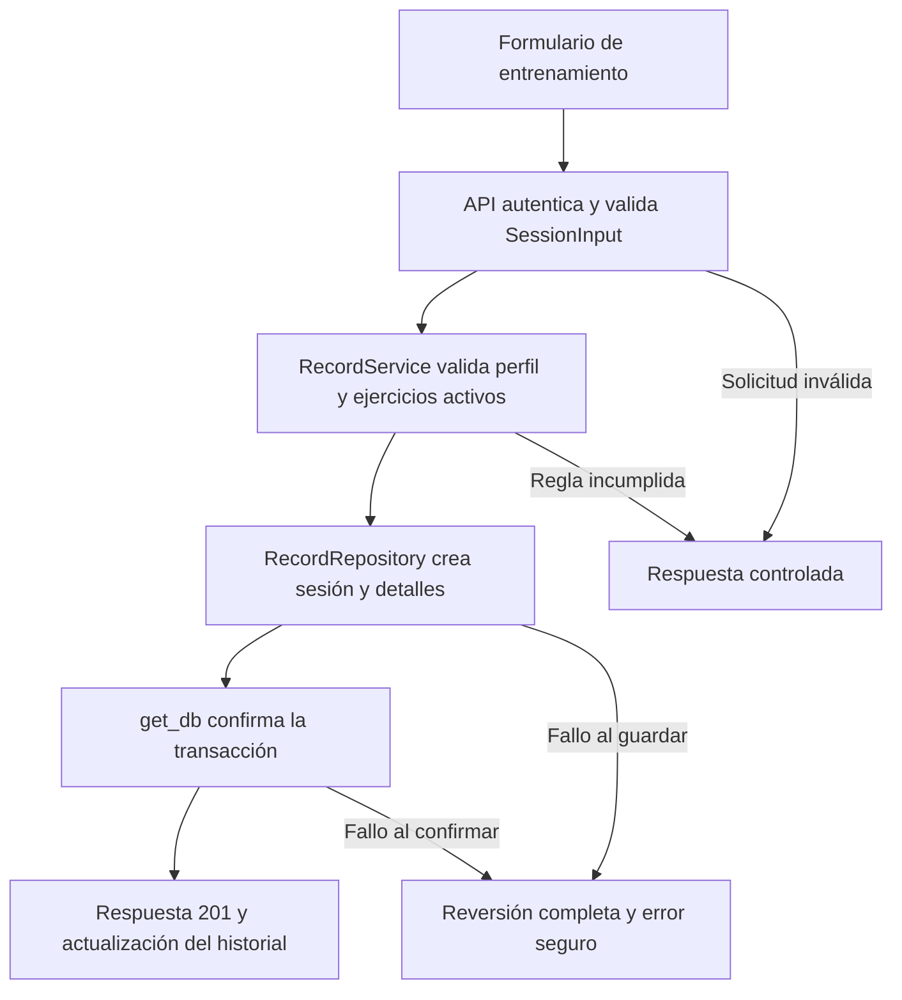

# Convenciones de FitAnalytics AI

Esta guía permite ampliar el seguimiento de entrenamientos con una misma organización de código y datos. El objetivo del sistema es registrar sesiones y mediciones, mostrar indicadores y estimar cargas con regresión lineal cuando el historial lo permite.

## Arquitectura y tecnologías

El sistema es un monolito modular con API: React y TypeScript presentan la interfaz; FastAPI recibe y valida solicitudes; los servicios aplican reglas; los repositorios consultan PostgreSQL mediante SQLAlchemy. Alembic versiona la estructura. Python permite compartir la lógica del backend con el análisis de scikit-learn; TypeScript comprueba los contratos utilizados por la interfaz.

Vercel publica el frontend, Render ejecuta la API y Supabase aloja PostgreSQL. La base del servicio se llama `postgres` y las tablas del negocio están en el esquema privado `gym_app`. PostgreSQL es el motor de base de datos; no utiliza el motor InnoDB del ejemplo MySQL. El navegador accede a la API, sin consultar directamente las tablas.

## Nombres y organización

| Elemento                         | Convención aplicada                                      | Ejemplo real                         |
| -------------------------------- | -------------------------------------------------------- | ------------------------------------ |
| Tablas y columnas                | Minúsculas y `snake_case`; tablas de entidades en plural | `usuarios`, `sesiones`, `carga_kg`   |
| Clave primaria                   | `id`                                                     | `sesiones.id`                        |
| Clave foránea                    | Entidad singular seguida de `_id`                        | `usuario_id`, `ejercicio_id`         |
| Restricciones e índices          | Prefijos `pk_`, `fk_`, `uq_`, `ck_`, `ix_`               | `ix_sesiones_usuario_fecha`          |
| Clases Python y tipos TypeScript | `PascalCase`                                             | `RecordService`, `SessionInput`      |
| Funciones y variables Python     | `snake_case`                                             | `create_goal`, `user_id`             |
| Funciones y variables TypeScript | `camelCase`                                              | `errorMessage`, `exerciseId`         |
| Constantes                       | `UPPER_SNAKE_CASE`                                       | `SCHEMA`, `ADMIN_LOCK`               |
| Componentes React y sus archivos | `PascalCase`                                             | `RecordForm.tsx`, `SessionTable.tsx` |
| Módulos Python                   | Minúsculas y `snake_case`; agrupados por responsabilidad | `service.py`, `repository.py`        |

Se conservan las convenciones de cada lenguaje. Las FK usan `usuario_id`, no el prefijo `id_usuario` del ejemplo de la guía. `auditoria` es el nombre colectivo ya establecido para el registro de cambios. Los archivos Python pueden reunir varias clases relacionadas; no requieren un archivo por clase.

Los servicios coordinan reglas y los repositorios preparan consultas. Una nueva funcionalidad sigue este orden: revisar el contrato y los datos; crear una migración si cambia la estructura; implementar esquema, repositorio, servicio y ruta; conectar la interfaz; verificar reglas, permisos y errores. No se confirma una transacción dentro de un repositorio.

## Cuatro tablas reales y sus relaciones

| Tabla        | Campos principales y tipos PostgreSQL                                                                                                    | Relaciones y controles                                                                                         |
| ------------ | ---------------------------------------------------------------------------------------------------------------------------------------- | -------------------------------------------------------------------------------------------------------------- |
| `usuarios`   | `id INTEGER`, `nombre VARCHAR(100)`, `correo VARCHAR(254)`, `clave_hash TEXT`, `rol VARCHAR(10)`, `activo BOOLEAN`, `creado TIMESTAMPTZ` | PK `id`; correo único; rol `admin` o `usuario`; contraseña almacenada como hash.                               |
| `ejercicios` | `id INTEGER`, `nombre VARCHAR(80)`, `nombre_normalizado VARCHAR(80)`, `unidad VARCHAR(5)`, `activo BOOLEAN`                              | PK `id`; nombre normalizado único; unidad `kg`; desactivar conserva el historial.                              |
| `sesiones`   | `id INTEGER`, `usuario_id INTEGER`, `fecha DATE`                                                                                         | FK a `usuarios.id`; fecha desde 2000; índice por usuario y fecha. La API rechaza fechas futuras.               |
| `registros`  | `id INTEGER`, `sesion_id INTEGER`, `ejercicio_id INTEGER`, `series INTEGER`, `repeticiones INTEGER`, `carga_kg NUMERIC(4,1)`             | FK a sesión y ejercicio; series 1–20, repeticiones 1–100 y carga 0–600 kg. Borrado en cascada desde la sesión. |

Los `id` utilizan secuencias de PostgreSQL. `usuarios` también conserva los datos de perfil definidos en [el contrato API](api-contract.md). `registros` es la tabla de detalle que resuelve la relación muchos a muchos entre sesiones y ejercicios; una sesión puede contener varias cargas o repeticiones del mismo ejercicio. El esquema completo está en `app/modules/*/models.py` y `migrations/versions/`.

La fecha del entrenamiento es un dato de negocio, no una fecha de modificación técnica. `usuarios.creado`, `analisis.fecha` y `auditoria.fecha` registran eventos fechados. La tabla `auditoria` guarda actor, acción, recurso y detalle de cambios administrativos. No todas las tablas tienen campos de creación y actualización: esta guía describe la implementación existente, sin añadir columnas ficticias.

## Recorrido de registrar una sesión



1. `src/features/records/RecordForm.tsx` recoge fecha, ejercicios, series, repeticiones y cargas; `recordService.ts` envía JSON a `POST /sesiones`.
2. `CurrentUser` comprueba token, cuenta activa y propietario. `SessionInput` valida fechas, números y el límite de 1–20 registros.
3. `RecordService.create()` comprueba el perfil y consulta los ejercicios activos. Los errores de negocio generan respuestas 409 o 422.
4. `RecordRepository.create()` construye `Sesion` y sus `Registro`, y ejecuta `flush()` para obtener sus identificadores.
5. `get_db()` confirma antes de devolver éxito. Si falla el guardado o la confirmación, revierte la solicitud completa; nunca informa que una parte quedó guardada.
6. FastAPI devuelve `SessionOut`, sin hashes ni datos internos. La interfaz consulta de nuevo el historial.

Fragmento integrado de `app/modules/records/service.py`:

```python
def create(self, user: Usuario, data: SessionInput) -> Sesion:
    """Valida perfil y ejercicios activos y prepara la sesión completa para su guardado."""
    if not user.perfil_completo:
        raise HTTPException(409, "Completa tu perfil antes de registrar entrenamientos.")
    ids = {row.ejercicio_id for row in data.registros}
    if len(self.repository.enabled_exercises(ids)) != len(ids):
        raise HTTPException(422, "Hay ejercicios inexistentes o inactivos.")
    return self.repository.create(user.id, data)
```

## Tipos y documentación del código

Los cinco módulos (`users`, `records`, `dashboard`, `predictions`, `admin`) declaran tipos de parámetros y retornos y docstrings en sus servicios y repositorios. El docstring resume la responsabilidad y los resultados o condiciones relevantes; los comentarios se reservan para decisiones como bloqueos y conservación del historial.

`app/core/contracts.py` define los diccionarios internos mediante `TypedDict`, las páginas y las filas SQL. No cambia el JSON de la API. Los esquemas Pydantic conservan la validación de entradas y respuestas. TypeScript utiliza `strict: true`; Python usa anotaciones, validación Pydantic y revisión Ruff, sin afirmar que exista comprobación estática estricta de toda la aplicación.

## Seguridad y errores

Las consultas utilizan SQLAlchemy y parámetros enlazados; no se interpolan entradas en sentencias SQL. React representa texto sin inyectar HTML del usuario. La API valida datos, utiliza hash Argon2 y JWT, y comprueba rol y estado actuales en cada operación.

`app/core/errors.py` concentra las respuestas de error y `app/core/diagnostics.py` registra los eventos con un formato común: evento, operación, código HTTP, tipo de error, categoría y SQLSTATE cuando corresponde. La operación utiliza el método y la plantilla de ruta, no parámetros ni URL completa. No se registran cuerpos de solicitudes, cabeceras, tokens, contraseñas, valores SQL ni mensajes originales de las excepciones.

Los conflictos de integridad responden 409; los fallos de conexión, 503; los demás errores de base de datos o fallos inesperados, 500 con un mensaje general. La validación conserva 422 y los permisos conservan 401/403. Las excepciones inesperadas se capturan antes de que el servidor imprima una traza con datos sensibles. Los repositorios propagan los errores para que `get_db()` revierta la transacción y la capa HTTP responda.

## Git y revisión por pares

Cada cambio utiliza una rama `feature/*` desde `dev` actualizado con `main`. Los commits describen una sola intención en español y utilizan sufijos como `docs`, `refactor`, `test`, `fix` o `feat` según el cambio. El PR integra en `dev`; después se prepara el PR hacia `main`.

Antes de integrar, un compañero debe revisar desde su propia cuenta los archivos y las verificaciones del PR, dejar comentarios o solicitar cambios cuando corresponda y enviar su revisión con **Approve** cuando esté conforme. Los cambios solicitados se corrigen en la misma rama. La aprobación humana y las pruebas automáticas son evidencias distintas: una no sustituye a la otra.

Las comprobaciones están en [el README](../README.md#verificación) y GitHub Actions. Las pruebas de errores verifican que ni la respuesta ni los logs expongan secretos y que se conserven los códigos HTTP y CORS.
